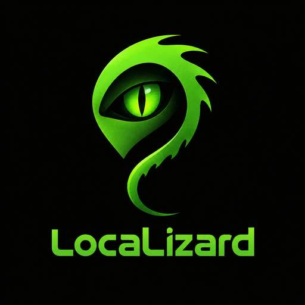

# LocaLizard 0.7.2.1

  

**LocaLizard** — графическая утилита для подготовки установочного ISO Windows IoT Enterprise LTSC с русским языком по умолчанию.

> **Версия 0.7.2.1:** централизованный реестр W10MUI/OSBuilder/Dexit, закреплённые metadata-провайдеры fydexx RS5 и RG-Adguard, справочные Microsoft ISO-ссылки WhatTheHack, расширенный перечень community-источников и отдельный мастер безопасного ручного импорта CAB/ESD/ISO/LXP. Поддержка W10MUI build 28000 сохранена; проверки Microsoft Authenticode и CBS Package Identity обязательны.

## Скачать

- [Последний релиз LocaLizard](https://github.com/lizardiot/LocaLizard/releases/latest)
- [Все релизы](https://github.com/lizardiot/LocaLizard/releases)
- [LocaLizard.exe для Windows x64 — версия 0.7.2.1](https://github.com/lizardiot/LocaLizard/releases/download/0.7.2.1/LocaLizard.exe)

## Возможности

- Управление онлайн-источниками LP/FoD на отдельном экране: W10MUI/OSBuilder/Dexit опрашиваются автоматически; community-площадки и внешние hash-каталоги доступны в режиме контролируемого импорта.
- Для W10MUI доступны списки build 28000; Dexit Gist работает для Windows 10 build 14393 x86/x64; fydexx подтверждает исторический RS5 build 17763 по SHA-1, а RG-Adguard — хеши точного имени файла.
- WhatTheHack предоставляет закреплённые справочные ссылки Microsoft Language ISO/FoD для Windows 10 20H2. Скрипт не запускается и ISO не скачивается автоматически.
- Ручной мастер импорта принимает CAB/ESD/ISO/APPX/MSIX и License.xml, сохраняет файлы в раздельные каталоги и пишет manual-imports.json с происхождением, размером, SHA-1 и SHA-256.

- Единственная целевая локализация — русский язык `ru-RU`; интерфейс и обработка языковых пакетов для других языков не добавляются.
- Базовый Client Language Pack в формате UUP ESD извлекается штатным DISM и устанавливается напрямую по `update.mum`, без лишней пересборки пакета в CAB. Загрузки с HTTP Microsoft Delivery CDN разрешены только для точных CDN-доменов/пути и при обязательной проверке SHA-1 и размера из UUP Dump.

- Перед обслуживанием выполняется предварительная проверка ISO, редакций, индексов, архитектуры, семейства сборки, источников обновлений и свободного места.
- Показываются предупреждения о завершении поддержки Windows IoT Enterprise LTSC; обработка архивных ISO при этом не блокируется.
- INF-драйверы интегрируются в офлайн-индексы `install.wim`; выбранный `unattend.xml` применяется через DISM.
- Полная локализация Setup/WinPE/WinRE требуется по умолчанию; создание частично локализованного результата возможно только при явном разрешении.
- Итоговый ISO сначала создаётся во временном файле, повторно проверяется и хешируется SHA-256; под конечным именем публикуется только после успешных проверок.
- Журнал этапов сборки сохраняется в `build-state.json`; параметры сборки можно экспортировать и импортировать в виде JSON-профилей.
- GUI для выбора входного ISO, выходного ISO, рабочего каталога, языковых источников и каталога обновлений.
- Поиск стабильных накопительных обновлений (LCU) или указанного KB через Microsoft Update Catalog.
- Фильтрация Preview/Insider/Canary, Windows Server и несовпадающей архитектуры до загрузки; пользователь подтверждает выбранную запись.
- Загрузка с доверенных HTTPS-доменов Microsoft Update, проверка доступного Catalog SHA-1 и вычисление SHA-256. Для каждого подготовленного набора создаются `updates.json`, `catalog-source.json` и `SHA256.txt`.
- Поиск Client/Server Language Pack ru-RU в совместимом ISO, управляемом кэше, UUP Dump, W10MUI, OSBuilder и закреплённом Gist Dexit для Windows 10 RS1; провайдеры централизованы, а сбой одного каталога не прерывает остальные. Перед servicing сверяются Microsoft-подпись и CBS Package Identity.
- Типизированные независимые источники для Microsoft Languages and Optional Features ISO, локального репозитория, ADK WinPE и WinRE; несовместимые build family, архитектура и тип ресурса отбрасываются.
- Определяет семейство сборки и архитектуру независимо от названия Windows; матрица включает IoT LTSC 2015/2016/2019/2021/2024, Windows 11 21H2/22H2/23H2/26H1 и Server 2016/2019/2022/2025. Для build 28000 Windows IoT совместимость намеренно не предполагается. Совместимость 23H2 с пакетами базовой семьи 22621 задана отдельным правилом; остальные неподтверждённые совпадения не угадываются.
- Настройка русской локали через DISM; инвентаризация Basic, Fonts, OCR, Text-to-Speech, Speech и Handwriting. FOD CAB принимаются только после проверки подписи Microsoft и CBS identity; для репозиториев с satellite packages используется DISM `/Export-Source` и `/Add-Capability`.
- Необязательная интеграция русских Language Experience Pack (LXP): локальный APPX/MSIX-каталог или Microsoft Store Product ID, проверка издателя, `ru-RU`, архитектуры, bundle manifests, зависимостей, подписи и соответствующего license XML до DISM provisioning.
- При наличии подходящих ресурсов — обработка Windows Setup `boot.wim` index 2, WinPE index 1 и вложенного WinRE.
- Работа с WIM/ESD и входными split-WIM `.swm`; опциональное разбиение итогового WIM на SWM для FAT32 и режим обслуживания существующего WIM в новый файл.
- Статическая проверка результата, журнал и JSON-аудит.
- Высота панели журнала регулируется мышью за верхний или нижний горизонтальный разделитель; изменение влияет только на вертикальный размер панели.
- Drag-and-drop для двух полей ISO: входного Windows ISO и необязательного русского ISO-донора. Перетащите файл в соответствующее поле; входной ISO также можно перетащить на главное окно.
- Необязательная интерактивная проверка загрузки ISO в Hyper-V: временная VM без сети, VMConnect, визуальное подтверждение экрана Setup и очистка VM.

## Ограничения и условия среды

- Для базового ru-RU Client Language Pack поддерживаются как CAB, так и UUP ESD: ESD распаковывается через DISM и устанавливается по `update.mum`; CAB из локального кэша и донорского ISO по-прежнему принимаются.

- Автопоиск последнего LCU использует семейство сборки и архитектуру выбранного ISO. Если для сборки нет заранее заданного профиля, выполняется поиск по номеру сборки и резервные запросы Microsoft Update Catalog. Автоматическая загрузка возможна только при наличии записи, которую удаётся однозначно сопоставить по семейству сборки, архитектуре и стабильному типу обновления. Если каталог изменил формат или не возвращает подходящей записи, программа остановится без угадывания пакета; можно указать KB вручную.
- Поиск Client Language Pack использует локальный кэш, донорский ISO и все совместимые клиентские записи, возвращённые UUP Dump API, без искусственного ограничения списка первыми 32 кандидатами. Перед загрузкой проверяется доступность `ru-RU` для нужной семьи сборки и архитектуры. Если совместимый отдельный Client Language Pack в формате CAB или UUP ESD недоступен ни в одном доверенном источнике, локализация соответствующего индекса не может быть продолжена. Окончательную применимость пакета проверяет DISM. Это относится к семействам LTSC 10240, 14393, 17763, 19044 и 26100; UUP Dump может не содержать архивных записей для всех старых выпусков, поэтому для них может потребоваться совместимый донорский ISO или локальный пакет.
- При отказе временной ссылки UUP Dump LocaLizard повторно запрашивает ссылку для того же пакета и принимает её только при совпадении имени, размера и SHA-1. Управляемый кэш фиксирует тип ресурса, `ru-RU`, архитектуру, семью сборки и исходный пакет.
- FOD ru-RU могут быть взяты из выбранного Microsoft L&O/FOD источника либо обнаружены через W10MUI/OSBuilder. Если нет полного совместимого источника или DISM не может подготовить satellite repository, необязательные возможности пропускаются; базовый Language Pack остаётся установленным. Итоговые состояния FOD фиксируются в JSON-аудите.
- Setup/WinPE и WinRE обслуживаются раздельно: используются донорские ресурсы или официальный ADK WinPE Add-on с проверкой подписи и архитектуры. При отсутствии совместимого пакета соответствующая часть образа отмечается в журнале и аудите; базовый Client Language Pack не откатывается.
- Hyper-V проверка загрузки ISO необязательна и не требуется для сборки или выпуска. При её запуске нужны Windows с включённым Hyper-V, права администратора и VMConnect; временная VM создаётся без сети, а отображение экрана Setup подтверждает пользователь. Этот интерактивный этап не выполняется в GitHub Actions.
- Статическая проверка проверяет структуру ISO и читаемость образов, но не гарантирует установку на каждой конфигурации оборудования. Дополнительная проверка ISO в отдельной VM или на тестовом устройстве рекомендуется, но не является обязательным условием сборки или выпуска. OOBE может повлиять на предпочитаемый язык интерфейса первого пользователя.
## Запуск

1. Скачайте `LocaLizard.exe` из [релиза 0.7.2](https://github.com/lizardiot/LocaLizard/releases/tag/0.7.2).
2. Запустите программу. Главное окно работает без повышения прав: исходный ISO можно перетащить в первую область, а донорский ISO с русским языком — в отдельную область раздела языковых компонентов. Подтвердите запрос UAC, когда программа начнёт операцию, требующую прав администратора.
3. Выберите исходный Windows ISO, путь для выходного ISO и рабочую папку.
4. При необходимости задайте русский ISO-источник, FOD/L&O и каталог обновлений.
5. Нажмите **«Проверить условия и создать ISO»**. Hyper-V тест можно включить отдельно; без него ISO создаётся в обычном режиме.

Python и инструменты разработки устанавливать вручную не требуется. Исходный ISO остаётся без изменений.

## История версий

### [0.7.2](https://github.com/lizardiot/LocaLizard/releases/tag/0.7.2) — текущий выпуск
Полностью переработан интерфейс Windows Forms: основной сценарий создания ISO отделён от компонентов, расширенных параметров, инструментов и технического журнала. Добавлены светлая, тёмная и системная темы с сохранением выбора, нижняя панель состояния, более компактная организация полей, Segoe UI и поддержка PerMonitorV2 DPI. Вспомогательные действия — предварительная проверка, обслуживание существующего WIM, Microsoft Update Catalog, диагностика UUP Dump и управление профилями — собраны в разделе инструментов. Существующие сценарии создания ISO, DISM/WIM, UUP Dump, FOD/LXP, обновлений, UAC, отмены, журналирования и импорта/экспорта профилей сохранены. CI успешно выполнил сборку .NET 10, smoke/regression tests, Windows DISM/WIM integration tests и публикацию автономной Windows x64 версии.

### [0.3.6](https://github.com/lizardiot/LocaLizard/releases/tag/0.3.6) — предыдущий выпуск
Поиск языковых пакетов расширен независимыми провайдерами W10MUI и OSBuilder: поддерживаются русские Client/Server LP и FOD-кандидаты с точным build family/архитектурой, Microsoft CDN URL policy, повторными редиректами и проверкой Authenticode/CBS identity. Добавлены typed resource model, compatibility matrix и локальные/Microsoft ISO/ADK WinPE/WinRE провайдеры. Управляемый репозиторий ведёт отдельный provenance manifest с source, resource type, ru-RU, архитектурой, build family, signer и SHA-1/SHA-256. FOD инвентаризируется по DISM capability state; монолитные языковые CAB используются напрямую, а FOD с satellite packages подготавливается через `/Export-Source`. Добавлен необязательный Store/LXP путь с проверкой APPX/MSIX manifests, Microsoft Publisher, архитектуры, зависимостей и license XML. Hyper-V остаётся необязательным; VM не запускается в CI. Другие языки не добавлялись.

### [0.2.7.6](https://github.com/lizardiot/LocaLizard/releases/tag/0.2.7.6) — предыдущий выпуск
Исправлен поиск `oscdimg.exe` в Windows ADK: вместо рекурсивного перечисления, которое могло аварийно завершаться при отсутствии доступа к отдельному системному каталогу, программа обходит каталоги по отдельным ветвям и продолжает поиск после пропуска недоступной папки. Добавлена обработка ошибок чтения найденных кандидатов и регрессионный тест, воспроизводящий отказ доступа во время ленивого перечисления. CI успешно проверяет сборку .NET 10, регрессионные тесты, Windows DISM WIM integration tests, автономную публикацию win-x64 и иконку приложения.

### [0.2.7.5](https://github.com/lizardiot/LocaLizard/releases/tag/0.2.7.5) — предыдущий выпуск
Основное приложение перенесено на C# / .NET 10 LTS Windows Forms. Перенесены сценарии подготовки ISO и обслуживания WIM, автоматический поиск и проверка Client Language Pack через UUP Dump, проверка целостности управляемого кэша, возобновляемая загрузка с повторами, Microsoft Update Catalog, манифесты цепочек обновлений, ADK/WinPE, Setup/WinPE/WinRE, SWM, patch-existing-WIM, аудит, UAC, drag-and-drop и диагностика UUP Dump. Добавлены регрессионные тесты и Windows DISM-интеграционный тест для двухиндексного WIM. CI проверяет сборку, тесты и автономный Windows x64 EXE. Применимость языковых CAB/MSU на конкретном образе IoT LTSC и сборку ISO на пользовательском носителе рекомендуется дополнительно проверить на целевой Windows-системе. Hyper-V проверка остаётся необязательной и не блокирует выпуск.

### [0.1.1.4](https://github.com/lizardiot/LocaLizard/releases/tag/0.1.1.4) — предыдущий выпуск
Исправлен параметр DISM для системной локали (/Set-SysLocale вместо несуществующего /Set-SystemLocale), а также разделена проверка базового Client Language Pack и последующая настройка образа: альтернативный пакет проверяется только при отказе /Add-Package. Необязательные FOD ограничены возможностями Basic, OCR, Text-to-Speech и Handwriting и запускаются только с указанным источником. Ошибки FOD больше не откатывают успешно добавленный базовый пакет; добавлены регрессионные тесты. Для полной локализации Setup по-прежнему требуется совместимый донорский ISO с каталогом sources/ru-ru.

### [0.1.1.3](https://github.com/lizardiot/LocaLizard/releases/tag/0.1.1.3) — предыдущий выпуск
Исправлены загрузка базового UUP ESD и установка Client Language Pack напрямую через update.mum с проверкой хеша.

### [0.1.1.1](https://github.com/lizardiot/LocaLizard/releases/tag/0.1.1.1) — текущий выпуск
Исправлена загрузка UUP Language Pack с Microsoft CDN: исходная HTTP-ссылка разрешается только для точного пути Microsoft Delivery CDN, а перенаправление обязано завершиться на HTTPS Microsoft/Windows Update. Диагностика отличает отсутствие пакета от сбоя его загрузки или преобразования. Добавлены тесты URL и конечного HTTPS-адреса.

### [0.1.1](https://github.com/lizardiot/LocaLizard/releases/tag/0.1.1) — предыдущий выпуск
UUP-поиск распознаёт Client Language Pack ESD и преобразует его в CAB с помощью DISM, SXSEXP и Windows makecab.

### [0.1.0.8](https://github.com/lizardiot/LocaLizard/releases/tag/0.1.1) — предыдущий выпуск
Автопоиск языковых компонентов выбирает клиентские сборки Windows 10/11, исключает Windows Server и Azure Stack HCI, а точная ревизия ISO имеет приоритет перед другими сборками того же семейства.

### [0.1.0.3](https://github.com/lizardiot/LocaLizard/releases/tag/0.1.0.3) — предыдущий выпуск
Проверка UUP Dump использует `/listid.php` и отдельно проверяет пять семейств Windows IoT Enterprise LTSC по номерам сборок 10240, 14393, 17763, 19044 и 26100.

### [0.1.0.2](https://github.com/lizardiot/LocaLizard/releases/tag/0.1.0.2) — предыдущий выпуск
Главное окно стало адаптивным: при уменьшении высоты элементы и текст не обрезаются, а доступны прокруткой; колонки и длинные подписи подстраиваются под ширину окна. Кнопки действий размещены в несколько строк, минимальный размер окна уменьшен.

### [0.1.0.1](https://github.com/lizardiot/LocaLizard/releases/tag/0.1.0.1) — предыдущий выпуск
Добавлена отдельная зона для перетаскивания донорского ISO с русским языком. Она заполняет поле «Русский ISO-источник», не изменяя путь входного ISO. Регистрация обеих зон drag-and-drop проверяется тестами.

### [0.1](https://github.com/lizardiot/LocaLizard/releases/tag/0.1) — предыдущий выпуск
Добавлены перетаскиваемые верхняя и нижняя границы панели журнала: высота меняется по вертикали, ширина интерфейса не меняется.

### [0.0.9.9](https://github.com/lizardiot/LocaLizard/releases/tag/0.0.9.9) — предыдущий выпуск
Автопоиск LCU поддерживает неизвестные заранее семьи сборок через резервные запросы Catalog с точной фильтрацией. Поиск Client Language Pack перебирает до пяти подходящих стабильных записей UUP Dump. Добавлен резервный поиск ресурсов WinRE в официальном ADK WinPE Add-on, исправлена достоверность JSON-аудита.

### [0.0.9.3](https://github.com/lizardiot/LocaLizard/releases/tag/0.0.9.3) — предыдущий выпуск
Исправлено перетаскивание ISO из Проводника Windows: главное окно запускается без прав администратора, а повышение прав запрашивается только при начале требующей их операции. Добавлены проверки передачи параметров в повышенный экземпляр.

### [0.0.9.2](https://github.com/lizardiot/LocaLizard/releases/tag/0.0.9.2) — предыдущий выпуск
Исправлено подключение ISO и добавлена диагностика отсутствующего Windows Virtual Disk provider.

### [0.0.9.1](https://github.com/lizardiot/LocaLizard/releases/tag/0.0.9.1) — предыдущий выпуск
Исправлена установка ADK после ошибки проверки хеша; актуализированы ссылки на установщики Microsoft.

### [0.0.9](https://github.com/lizardiot/LocaLizard/releases/tag/0.0.9) — предыдущий выпуск
Поиск и подготовка обновлений через Microsoft Update Catalog; релиз содержит только журнал изменений версии 0.0.9. Интерактивная Hyper-V проверка просит подтвердить экран Setup.

### [0.0.8.9](https://github.com/lizardiot/LocaLizard/releases/tag/0.0.8.9) — предыдущий выпуск
Повышена устойчивость загрузок и проверок кэша; добавлены цепочки обновлений через явный `updates.json`, обработка Setup/WinPE/WinRE при наличии совместимых ресурсов, поддержка SWM и обслуживание существующего WIM. Автоматический поиск LCU через Microsoft Update Catalog ещё не входил в этот выпуск.

### [0.0.8.1](https://github.com/lizardiot/LocaLizard/releases/tag/0.0.8.1) — предыдущий выпуск
Улучшены выбор стабильных источников UUP и проверка архитектуры, повторные загрузки с возобновлением, проверка кэша и аудит локализации. Перед установкой ADK добавлены дополнительные проверки ISO и подписи установщика. WinPE index 1 и WinRE в этом выпуске не изменялись.

### [0.0.2](https://github.com/lizardiot/LocaLizard/releases/tag/0.0.2) — предыдущий выпуск
Добавлен дополнительный русский ISO-источник для поиска клиентского Language Pack, FOD и компонентов Setup/WinPE. Исходный целевой ISO не заменяется, а применимость найденных пакетов проверяется через DISM.

### [0.0.1.9](https://github.com/lizardiot/LocaLizard/releases/tag/0.0.1.9) — предыдущий выпуск
Уточнён поиск базового русского клиентского Language Pack: совпадение SKU в имени CAB больше не обязательно, но проверяются язык и архитектура, а окончательную совместимость определяет DISM. Улучшена диагностика и публикация релизов с сохранением предыдущих тегов.

### [0.0.1.8](https://github.com/lizardiot/LocaLizard/releases/tag/0.0.1.8) — предыдущий выпуск
Проект и исполняемый файл переименованы в LocaLizard. Добавлены Windows GUI для выбора ISO, проверка структуры результата, журналирование, JSON-отчёт, поиск пакетов ru-RU через UUP Dump API и сборка автономного Windows x64 EXE.

## Документация

- [CHANGELOG.md](CHANGELOG.md) — история разработки в репозитории.
- [Релизы LocaLizard](https://github.com/lizardiot/LocaLizard/releases)
- [Microsoft: добавление языковых пакетов Windows](https://learn.microsoft.com/windows-hardware/manufacture/desktop/add-language-packs-to-windows?view=windows-11)
- [Microsoft: языковые компоненты и FOD](https://learn.microsoft.com/windows-hardware/manufacture/desktop/languages-overview?view=windows-11)
- [Windows IoT Enterprise overview](https://learn.microsoft.com/en-us/windows/iot/iot-enterprise/overview)
- [UUP Dump](https://uupdump.net/)
