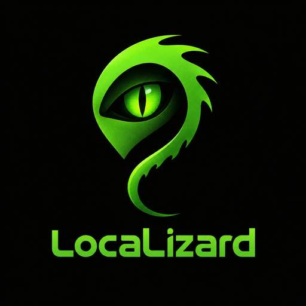

# LocaLizard 0.7.2.1

  

**LocaLizard** is a graphical utility for preparing Windows IoT Enterprise LTSC installation media with Russian as the default language.

> **Version 0.7.2.1:** centralizes W10MUI/OSBuilder/Dexit discovery, adds pinned fydexx RS5 and RG-Adguard hash metadata, exposes pinned WhatTheHack Microsoft ISO references, expands the community source directory, and adds verified import plus controlled direct HTTPS/BitTorrent downloads for CAB/ESD/ISO/LXP. Windows 11 26H1 build 28000 metadata support remains; Microsoft Authenticode and CBS Package Identity checks are still mandatory.

## Download

- [Latest LocaLizard release](https://github.com/lizardiot/LocaLizard/releases/latest)
- [All releases](https://github.com/lizardiot/LocaLizard/releases)
- [LocaLizard.exe for Windows x64 — version 0.7.2.1](https://github.com/lizardiot/LocaLizard/releases/download/0.7.2.1/LocaLizard.exe)

## Features

- Centralized source registry with parallel W10MUI/OSBuilder/Dexit discovery; pinned fydexx RS5 provides exact filename/architecture/SHA-1 metadata, and RG-Adguard provides exact-file hash/size cross-checks.
- WhatTheHack exposes two pinned historical Microsoft ISO URLs for Windows 10 20H2; the wizard can download and import them directly without executing the PowerShell script.
- W10MUI Windows 11 26H1 build 28000 LP/FoD catalogs are supported for the client family; Windows IoT compatibility is deliberately not inferred.
- The import wizard supports local files and direct HTTPS downloads for CAB/ESD/ISO/APPX/MSIX and License.xml, computes SHA-1/SHA-256, and writes a provenance manifest. Community URLs are restricted to the selected source's own HTTPS host and require an independent checksum.

- BitTorrent hand-off is available through a locally installed aria2c: users provide a magnet URI or a .torrent file, and only supported package/media file types are offered to the normal import checks.
- Russian `ru-RU` is the only target language; no other language support or language selection is being added.
- The base UUP Client Language Pack ESD is extracted with native DISM and installed directly from `update.mum`, avoiding an unnecessary CAB rebuild. HTTP Microsoft Delivery CDN responses are permitted only for the exact CDN hosts/path and only with the SHA-1 and file size supplied by UUP Dump.

- Before servicing, the application preflights the ISO, editions, indexes, architecture, build family, update sources and available disk space.
- Windows IoT Enterprise LTSC end-of-support warnings are displayed without blocking work with archival ISO images.
- INF drivers can be integrated into offline `install.wim` indexes, and a selected `unattend.xml` can be applied through DISM.
- Full Setup/WinPE/WinRE localization is required by default; partially localized output is available only with explicit opt-in.
- The output ISO is first created as a temporary file, read back and checked with SHA-256; it is published under its final name only after validation succeeds.
- Build stages are recorded in `build-state.json`, and build settings can be exported to and imported from JSON profiles.
- GUI for selecting the source ISO, output ISO, working directory, language sources, and update catalog.
- Search for stable cumulative updates (LCUs) or a specified KB through Microsoft Update Catalog.
- Filters Preview/Insider/Canary, Windows Server, and architecture mismatches before download; the user reviews and confirms the selected entry.
- Downloads from trusted Microsoft Update HTTPS domains, verifies the available Catalog SHA-1, and calculates SHA-256. Each prepared update set includes `updates.json`, `catalog-source.json`, and `SHA256.txt`.
- Discovers Russian Client/Server Language Packs in compatible ISOs, the managed cache, UUP Dump, W10MUI, and historical OSBuilder catalogs; Microsoft signatures and CBS Package Identity are checked before servicing.
- Provides typed independent sources for Microsoft Languages and Optional Features media, local repositories, ADK WinPE, and WinRE; mismatched build families, architectures, and resource types are rejected.
- Detects the image build family and architecture independently of the Windows release label. The compatibility matrix includes IoT LTSC 2015/2016/2019/2021/2024, Windows 11 21H2/22H2/23H2, and Server 2016/2019/2022/2025. Windows 11 23H2 explicitly accepts its 22621 base package family; other unverified build matches are not guessed.
- Configures the Russian locale through DISM and inventories Basic, Fonts, OCR, Text-to-Speech, Speech, and Handwriting. FOD CABs are accepted only after Microsoft signature and CBS identity checks; satellite repositories use DISM `/Export-Source` and `/Add-Capability`.
- Optional Russian Language Experience Pack provisioning supports a local APPX/MSIX repository or a Microsoft Store Product ID. Publisher, `ru-RU`, architecture, bundle manifests, dependencies, signature, and the matching license XML are checked before DISM provisioning.
- When compatible resources are available, processes Windows Setup `boot.wim` index 2, WinPE index 1, and nested WinRE.
- Supports WIM/ESD and input split-WIM `.swm` files; optionally splits the output WIM into SWM parts for FAT32 and processes an existing WIM into a new file.
- Static result validation, logging, and a JSON audit report.
- Resize the log panel vertically by dragging its upper or lower horizontal sash; the interface width is unaffected.
- Drag-and-drop is supported for both ISO fields: the input Windows ISO and the optional Russian ISO donor. Drop each file onto its corresponding field; the input ISO can also be dropped onto the main window.
- Optional interactive Hyper-V ISO boot test using a temporary VM without network access, VMConnect, visual confirmation of the Setup screen, and VM cleanup.

## Limitations and environment

- BitTorrent requires `aria2c.exe` in PATH or beside the application. LocaLizard does not bypass authentication, CAPTCHAs, or browser sessions; protected .torrent files must first be obtained by the user in a browser.
- Direct community downloads work only with a direct HTTPS file URL on the selected source's own host (or a trusted Microsoft CDN redirect) and require an independent SHA-1/SHA-256. Search pages, expiring links, cloud folders, and unsupported external mirrors must be downloaded in a browser and imported locally.
- WhatTheHack downloads use official historical Microsoft URLs and calculate SHA-256 after transfer, but that source does not publish an independent checksum; compatibility of its Windows 10 20H2 media with the selected image is checked separately.
- m417z remains a reference for source MUI/RC resources. Those resources are not installable CAB/ESD packages and are not automatically converted into a Windows Language Pack. requirements

- The base ru-RU Client Language Pack supports both CAB and UUP ESD sources. ESD is extracted by DISM and serviced through `update.mum`; local CAB packages and donor ISO packages remain supported.

- Latest-LCU search uses the build family and architecture detected from the selected ISO. If a build has no predefined query profile, the utility searches by numeric OS build and tries fallback Microsoft Update Catalog queries. Automatic download still requires an unambiguous stable update matching the exact build family and architecture. If the Catalog HTML changes or no matching entry is returned, the utility stops rather than guessing; a KB can be entered manually.
- Client Language Pack discovery checks the local cache, a donor ISO, and every compatible client installation build returned by the UUP Dump API after a ru-RU language availability check for the same build family and architecture; the candidate list is no longer capped at 32. Localization of an image index cannot continue if no compatible standalone Client Language Pack in CAB or UUP ESD form is available from trusted sources. DISM performs the final applicability check. This covers LTSC build families 10240, 14393, 17763, 19044, and 26100; UUP Dump may not retain entries for every older release, so a compatible donor ISO or local package may be required.
- If a temporary UUP URL expires, LocaLizard resolves a fresh URL for the same package and verifies that its name, size, and SHA-1 have not changed. Managed cache schema 2 records the source package, resource type, `ru-RU`, architecture, and build family.
- Russian FOD components can come from a selected Microsoft Languages and Optional Features/FOD source or be discovered through W10MUI/OSBuilder metadata. If no compatible source exists or DISM cannot prepare a required satellite repository, optional capabilities are skipped; the base Language Pack remains installed. Results are recorded in the JSON audit.
- Setup/WinPE and WinRE are serviced separately using compatible donor resources or the official ADK WinPE Add-on, with signature and architecture validation. If no compatible package is available, that image component is left unchanged and the result is recorded; the base Client Language Pack is not rolled back.
- The Hyper-V ISO boot check is optional and is not required to build or release an ISO. When selected, it requires Windows with Hyper-V enabled, administrator privileges, and VMConnect. The temporary VM has no network adapter, and the user confirms that the Setup screen appeared. This manual step is not run in GitHub Actions.
- Static validation checks the ISO structure and whether images can be read, but cannot guarantee installation on every hardware configuration. An additional test in a separate VM or on a test device is recommended, but is not a build or release requirement. OOBE can affect the preferred UI language of the first user.
## Run

1. Download `LocaLizard.exe` from the [0.7.2 release](https://github.com/lizardiot/LocaLizard/releases/tag/0.7.2).
2. Run the application. The main window runs without elevation: drag the target ISO into the first drop zone and the Russian donor ISO into the separate zone in the language-components section. Approve the UAC prompt when the application starts an operation that requires administrator privileges.
3. Select the source Windows ISO, output ISO path, and working directory.
4. If needed, specify a Russian ISO source, FOD / Language and Optional Features sources, and an update catalog.
5. Click **Check prerequisites and create ISO**. The Hyper-V test can be enabled separately; ISO creation works without it.

You do not need to install Python or development tools manually. The source ISO remains unchanged.

## Version history

### [0.7.2](https://github.com/lizardiot/LocaLizard/releases/tag/0.7.2) — current release
Redesigned the Windows Forms interface: the main ISO creation workflow is separated from components, advanced settings, tools, and the technical log. Added light, dark, and system themes with persisted selection, a bottom status bar, more compact field layout, Segoe UI, and PerMonitorV2 DPI support. Auxiliary actions—including preflight checks, existing-WIM servicing, Microsoft Update Catalog, UUP Dump diagnostics, and profile management—are grouped in the Tools section. Existing ISO creation, DISM/WIM, UUP Dump, FOD/LXP, update, UAC, cancellation, logging, and profile import/export workflows are retained. CI successfully completed the .NET 10 build, smoke/regression tests, Windows DISM/WIM integration tests, and self-contained Windows x64 publishing.

### [0.3.6](https://github.com/lizardiot/LocaLizard/releases/tag/0.3.6) — previous release
Language discovery now includes independent W10MUI and OSBuilder providers for Russian Client/Server LP and FOD candidates, with exact build/architecture filtering, Microsoft CDN URL policy, redirect validation, Authenticode and CBS identity checks. A typed resource model, compatibility matrix, and local/Microsoft ISO/ADK WinPE/WinRE providers were added. The managed repository records source, resource type, `ru-RU`, architecture, build family, signer, SHA-1, and SHA-256 provenance. FOD capability state is inventoried through DISM; monolithic language CABs are used as direct sources, while satellite packages use `/Export-Source`. Optional Store/LXP discovery and provisioning validates APPX/MSIX manifests, Microsoft Publisher, architecture, dependencies, and matching license XML. Hyper-V remains optional and is not run in CI. No additional languages were added.

### [0.2.7.6](https://github.com/lizardiot/LocaLizard/releases/tag/0.2.7.6) — previous release
Fixed Windows ADK `oscdimg.exe` discovery. Instead of recursive enumeration that could abort when a protected system folder denied access, the application now traverses directories branch by branch and continues searching after skipping an inaccessible folder. Added isolated handling for unreadable candidate files and a regression test that simulates access denial during lazy directory enumeration. CI successfully builds .NET 10, runs regression tests and Windows DISM WIM integration tests, publishes the self-contained win-x64 application, and verifies its icon.

### [0.2.7.5](https://github.com/lizardiot/LocaLizard/releases/tag/0.2.7.5) — previous release
The primary Windows application was migrated to C# / .NET 10 LTS Windows Forms. The port covers ISO/WIM servicing, UUP Dump Client Language Pack discovery and verification, managed cache integrity, resumable downloads, Microsoft Update Catalog, ordered update manifests, ADK/WinPE, Setup/WinPE/WinRE localization, SWM, patch-existing-WIM, audit, UAC, drag-and-drop, and UUP diagnostics. Regression tests and a Windows DISM integration test for a two-index WIM were added. CI builds and publishes the standalone Windows x64 app. Applying language CAB/MSU packages to specific IoT LTSC images, building a real user ISO, and visually checking Hyper-V boot remain target-environment validation steps; CI does not claim those steps have been performed.

### [0.1.1.4](https://github.com/lizardiot/LocaLizard/releases/tag/0.1.1.4) — previous release
Fixed the invalid DISM system-locale switch (/Set-SysLocale replaces /Set-SystemLocale) and separated base Client Language Pack candidate selection from later servicing, so another LP is tried only when /Add-Package rejects the current one. Optional Russian FODs are limited to Basic, OCR, Text-to-Speech, and Handwriting and are attempted only with a selected source. Optional FOD failures no longer roll back a successfully added base package. Added regression tests. Full Windows Setup resource localization still requires a compatible Russian donor ISO containing sources/ru-ru.

### [0.1.1.3](https://github.com/lizardiot/LocaLizard/releases/tag/0.1.1.3) — previous release
Fixed Microsoft CDN ESD download handling and installed the extracted base Client Language Pack directly through update.mum with integrity verification.

### [0.1.1.3](https://github.com/lizardiot/LocaLizard/releases/tag/0.1.1.3) — current release
Fixed Microsoft Delivery CDN downloads when the final URL remains HTTP: the exact Microsoft CDN host/path is accepted only when UUP metadata provides a valid SHA-1 and expected file size. Base Client Language Pack ESD files are now extracted by DISM and installed directly through `update.mum`, without rebuilding a CAB; the extracted manifest is cached and verified. Added regression tests for the HTTP integrity policy and update.mum discovery.

### [0.1.1.1](https://github.com/lizardiot/LocaLizard/releases/tag/0.1.1.1) — previous release
Fixed UUP Language Pack downloads from Microsoft Delivery CDN. HTTP is permitted only as a narrowly scoped bootstrap URL for the exact Microsoft CDN host and file path; the final URL after redirects must be trusted HTTPS. Diagnostics now distinguish a missing package from a detected package whose download, verification, or ESD conversion failed. Added URL policy and HTTPS-redirect tests.

### [0.1.1](https://github.com/lizardiot/LocaLizard/releases/tag/0.1.1) — previous release
UUP search recognizes Client Language Pack ESD files, converts them into CAB packages with DISM, SXSEXP and Windows makecab, checks ru-RU availability before requesting file metadata, and skips non-installation OOBE/servicing records.

### [0.1.0.8](https://github.com/lizardiot/LocaLizard/releases/tag/0.1.1) — previous release
Language-component discovery now selects Windows 10/11 client builds, excludes Windows Server and Azure Stack HCI, and prefers the exact ISO revision before other builds from the same family.

### [0.1.0.3](https://github.com/lizardiot/LocaLizard/releases/tag/0.1.0.3) — previous release
The UUP Dump check uses `/listid.php` and separately checks all five Windows IoT Enterprise LTSC build families: 10240, 14393, 17763, 19044, and 26100.

### [0.1.0.2](https://github.com/lizardiot/LocaLizard/releases/tag/0.1.0.2) — previous release
The main window is now responsive: when its height is reduced, controls and text remain accessible through scrolling instead of being clipped. Columns and long labels adapt to the available width, action buttons flow into multiple rows, and the minimum window size is smaller.

### [0.1.0.1](https://github.com/lizardiot/LocaLizard/releases/tag/0.1.0.1) — previous release
Added a dedicated drop zone for the Russian donor ISO. Dropping into it fills the “Russian ISO source” field without changing the target ISO path. Both drag-and-drop zones are covered by tests.

### [0.1](https://github.com/lizardiot/LocaLizard/releases/tag/0.1) — previous release
Added draggable upper and lower horizontal sashes for the log panel. Dragging changes the panel height vertically without changing the interface width.

### [0.0.9.9](https://github.com/lizardiot/LocaLizard/releases/tag/0.0.9.9) — previous release
Latest-LCU search now supports previously unknown build families through fallback Catalog queries with strict filtering. Client Language Pack discovery checks up to five matching stable UUP Dump entries. WinRE can fall back to compatible resources from the official ADK WinPE Add-on, and the JSON audit reports actual results.

### [0.0.9.3](https://github.com/lizardiot/LocaLizard/releases/tag/0.0.9.3) — previous release
Fixed dragging ISO files from Windows Explorer: the main window starts without administrator privileges, and elevation is requested only when an operation requires it. Added regression checks for arguments passed to the elevated instance.

### [0.0.9.2](https://github.com/lizardiot/LocaLizard/releases/tag/0.0.9.2) — previous release
Fixed ISO mounting and added diagnostics for a missing Windows Virtual Disk provider.

### [0.0.9.1](https://github.com/lizardiot/LocaLizard/releases/tag/0.0.9.1) — previous release
Fixed ADK installation after a hash-check error and updated links to Microsoft installers.

### [0.0.9](https://github.com/lizardiot/LocaLizard/releases/tag/0.0.9) — previous release
Added update search and preparation through Microsoft Update Catalog. This release contains only the version 0.0.9 changelog; the interactive Hyper-V test asks the user to confirm the Setup screen.

### [0.0.8.9](https://github.com/lizardiot/LocaLizard/releases/tag/0.0.8.9) — previous release
Improved download reliability and cache validation; added update chains through an explicit `updates.json`, Setup/WinPE/WinRE processing when compatible resources are available, SWM support, and processing of an existing WIM. Automatic LCU search through Microsoft Update Catalog was not yet included.

### [0.0.8.1](https://github.com/lizardiot/LocaLizard/releases/tag/0.0.8.1) — previous release
Improved stable UUP source selection and architecture checks, retryable and resumable downloads, cache validation, and localization auditing. Added extra ISO checks and installer-signature verification before ADK installation. WinPE index 1 and WinRE were not modified in this release.

### [0.0.2](https://github.com/lizardiot/LocaLizard/releases/tag/0.0.2) — previous release
Added an additional Russian ISO source for finding the Client Language Pack, FOD, and Setup/WinPE components. The target ISO is not replaced, and DISM is used to check whether the discovered packages are applicable.

### [0.0.1.9](https://github.com/lizardiot/LocaLizard/releases/tag/0.0.1.9) — previous release
Refined discovery of the base Russian Client Language Pack: an exact SKU match in the CAB filename is no longer required, but language and architecture are checked, and DISM determines final compatibility. Improved diagnostics and release publishing while preserving previous tags.

### [0.0.1.8](https://github.com/lizardiot/LocaLizard/releases/tag/0.0.1.8) — previous release
Renamed the project and executable to LocaLizard. Added a Windows GUI for ISO selection, output-structure validation, logging, JSON reports, ru-RU package discovery through the UUP Dump API, and standalone Windows x64 builds.

## Documentation

- [CHANGELOG.md](CHANGELOG.md) — project development history.
- [LocaLizard releases](https://github.com/lizardiot/LocaLizard/releases)
- [Microsoft: Add language packs to Windows](https://learn.microsoft.com/windows-hardware/manufacture/desktop/add-language-packs-to-windows?view=windows-11)
- [Microsoft: Languages and optional features](https://learn.microsoft.com/windows-hardware/manufacture/desktop/languages-overview?view=windows-11)
- [Windows IoT Enterprise overview](https://learn.microsoft.com/en-us/windows/iot/iot-enterprise/overview)
- [UUP Dump](https://uupdump.net/)
